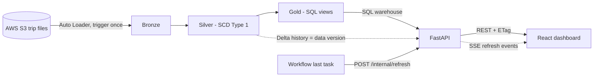
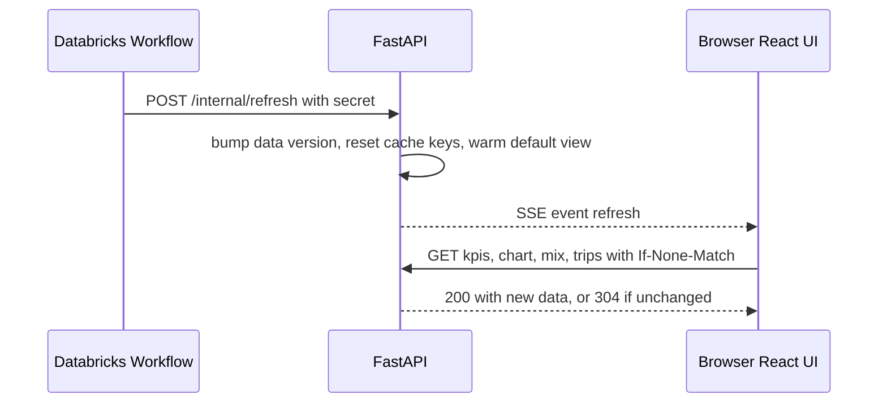

# 🚕 Transit Analytics Platform

> An end-to-end analytics project: a **Databricks medallion lakehouse** for trip data across Indian cities, a secure **FastAPI** service that serves it, and a **React** dashboard that refreshes the moment new data lands.


---

## 📚 Table of contents

1. [Overview](#-overview)
2. [Repositories](#-repositories)
3. [Architecture](#-architecture)
4. [Data layer: Databricks](#-data-layer-databricks)
5. [Backend: FastAPI](#-backend-fastapi)
6. [Frontend: React](#-frontend-react)
7. [Getting started](#-getting-started)
8. [Configuration](#-configuration)
9. [Testing](#-testing)
10. [Deployment notes](#-deployment-notes)
11. [Design decisions](#-design-decisions)
12. [Known limitations](#-known-limitations)
13. [Project status and roadmap](#-project-status-and-roadmap)

---

## 🔎 Overview

The platform answers one question: **"How are trips, sales and ratings doing in each city, and is the data up to date?"**

- 🏗️ **Databricks** ingests raw trip files from S3 and builds Bronze, Silver and Gold layers with data-quality checks.
- ⚙️ **FastAPI** exposes the Gold layer through a small, cached, authenticated API and tells clients when new data arrives.
- 🖥️ **React** shows KPIs, charts and tables, and refetches automatically when the API announces a refresh.

| | |
|---|---|
| **Data** | 356K+ trip records, about 1.8K new records per day, Aug to Dec 2025 |
| **Coverage** | 10 cities plus an "all cities" view |
| **Cities** | Chandigarh, Coimbatore, Indore, Jaipur, Kochi, Lucknow, Mysore, Surat, Vadodara, Visakhapatnam |
| **Freshness** | Daily batch load, dashboard updates within seconds of the pipeline finishing |

---

## 🗂️ Repositories

| Layer | Repository | What it contains |
|---|---|---|
| 🧱 **Data** | [transportation-data-lakehouse](https://github.com/daya1an/transportation-data-lakehouse) | Databricks pipelines: Bronze, Silver, Gold, expectations, Workflow |
| ⚙️ **API** | [transportation-api](https://github.com/daya1an/transportation-api) | FastAPI service, tests, Postman collection, Dockerfile |
| 🖥️ **UI** | [transportation-ui](https://github.com/daya1an/transportation-ui) | React dashboard (Vite, Tailwind, PrimeReact) |

---

## 🏛️ Architecture



### How the pieces talk

| From | To | How | Why |
|---|---|---|---|
| React | FastAPI | REST for data, **SSE** for live "refresh" signals | One-way push is all we need |
| FastAPI | Databricks | Plain SQL over a SQL warehouse | Databricks cannot push, so we ask |
| Databricks Workflow | FastAPI | Webhook `POST /internal/refresh` | Instant notice when a load finishes |

### What happens when new data lands



---

## 🧱 Data layer: Databricks

Repository: [transportation-data-lakehouse](https://github.com/daya1an/transportation-data-lakehouse)

A scalable **medallion lakehouse** built with **Spark Declarative Pipelines**.

| Layer | Purpose |
|---|---|
| 🥉 **Bronze** | Raw trip files from AWS S3, ingested incrementally with **Auto Loader** in trigger-once mode |
| 🥈 **Silver** | Cleaned and deduplicated trips, **SCD Type 1** updates, **data-quality expectations** |
| 🥇 **Gold** | SQL views for BI: `fact_trips` (all cities) plus one view per city, joined with city and calendar dimensions |

Highlights:

- ✅ Declarative approach cut pipeline code by about 63 percent
- ✅ Incremental batch loads, about 1.8K new records a day
- ✅ Gold views expose ready-to-query columns such as `business_date`, `city_name`, `passenger_category`, `distance_kms`, `sales_amt`, ratings and calendar fields

---

## ⚙️ Backend: FastAPI

Repository: [transportation-api](https://github.com/daya1an/transportation-api)

### ✨ Features

- 📊 **Dashboard endpoints**: meta, KPIs with % change vs the previous period, stacked chart series, sales mix, paged and sortable trips
- 📥 **CSV export**: streamed in chunks with a row cap and spreadsheet formula-injection protection
- 🔴 **Live refresh over SSE** with heartbeats and reconnect catch-up
- 🔗 **Webhook** to announce new data, plus a **poller** as a fallback
- 🧭 **Table explorer** for debugging, limited to whitelisted tables
- 🧪 **79 automated tests** and an importable **Postman collection** with automatic checks

### 🔌 Endpoints

| Method | Path | Auth | Purpose |
|---|---|---|---|
| GET | `/health` | none | Liveness |
| GET | `/health/db` | token | Warehouse reachability |
| GET | `/auth/config` | none | Tells the UI whether login is required |
| POST | `/auth/login` | none, rate limited | Access key to JWT |
| POST | `/auth/sse-ticket` | token | Short-lived ticket for the SSE URL |
| GET | `/api/meta` | token | Cities, date range, data version |
| GET | `/api/kpis` | token | Totals with change vs previous period |
| GET | `/api/chart?granularity=` | token | Weekly, monthly or yearly stacked series |
| GET | `/api/mix` | token | Sales share by city, or by category for one city |
| GET | `/api/trips` | token | Paged rows with sort and search |
| GET | `/api/export.csv` | token | Streamed CSV download |
| GET | `/api/events` | token or ticket | SSE stream |
| GET | `/api/explorer/tables`, `/tables/{city}/columns`, `/tables/{city}/sample` | token | Debug explorer |
| POST | `/internal/refresh` | webhook secret | Announce new data |

Every error has the same shape: `{ "code": "...", "message": "..." }`.

### 🧠 How freshness works

- **Data version**: derived from the Delta history of `silver.trips`, so even SCD Type 1 in-place updates are noticed. Housekeeping commits (OPTIMIZE, VACUUM, DLT SETUP) are ignored.
- **Cache**: in-memory TTL cache with single-flight loading, keyed by data version, so a refresh invalidates everything at once.
- **ETag and 304**: unchanged refetches cost almost nothing.
- **Warm-up**: the default view is prefetched after each refresh, so the first visitor is fast.

### 🔐 Security and hardening

- 🔑 JWT access tokens plus **single-purpose SSE tickets**, because `EventSource` cannot send headers
- 🚦 Per-IP **rate limits** (strict on login and webhook)
- 🧱 Clients send a **city key, never a table name**, and identifiers are whitelisted
- 🛡️ Constant-time secret comparison, security headers, request IDs
- 📝 JSON logs that never record query strings, so tickets do not leak
- ⏱️ Warehouse-side query timeout and a fast "busy" answer instead of piling up requests

### 🧩 Code structure

```
transportation-api/
├── app/
│   ├── main.py            # composition root, wires everything together
│   ├── config.py          # typed settings from environment
│   ├── routers/           # thin HTTP layer
│   ├── services/          # business logic (dashboard, export, explorer, filters)
│   ├── repositories/      # SQL, caching decorator, data version sources
│   ├── db/                # Databricks executor with pooling and timeouts
│   ├── realtime/          # SSE broker, stream, poller
│   ├── domain/            # city whitelist and core types
│   └── auth.py, security.py, limits.py, cache.py, observability.py, ...
├── tests/                 # pytest suite with fakes, no Databricks needed
├── postman/               # collection and environment
├── Dockerfile
└── requirements.txt
```

Built around **SOLID** ideas: small interfaces, a caching **decorator** around the repository, dependency injection, and a single composition root.

---

## 🖥️ Frontend: React

Repository: [transportation-ui](https://github.com/daya1an/transportation-ui)

### 🧰 Stack

⚛️ React (JavaScript) · ⚡ Vite · 🎨 Tailwind CSS v4 · 🍬 PrimeReact 10 · 🔄 TanStack Query · 🧭 React Router

### ✨ What is built

- 🌗 **Switchable light and dark theme**: follows the OS on first visit, remembers your choice, no flash on load
- 🔐 **Login** with clear messages for wrong key, rate limit and server down, token kept in `sessionStorage`
- 🧱 **API layer** with typed errors, automatic logout on 401 and request cancellation
- 📡 **Live connection**: SSE with fresh tickets on every reconnect, exponential backoff with jitter, a watchdog for silent drops, and one refetch after any reconnect
- 🟢 **Live badge** showing Live, Connecting, Reconnecting or Offline
- 🧪 **36 automated tests** covering the API client, auth flow, theme switching and the live connection

```
transportation-ui/
├── src/
│   ├── api/          # fetch wrapper and one function per endpoint
│   ├── auth/         # token store, AuthProvider, RequireAuth
│   ├── realtime/     # LiveConnection and refresh provider
│   ├── hooks/        # TanStack Query hooks
│   ├── theme/        # theme helpers, provider, toggle
│   ├── components/   # app shell, live badge
│   └── pages/        # login and dashboard
└── scripts/          # copies PrimeReact light and dark themes
```

---

## 🚀 Getting started

### Prerequisites

- Python 3.10+ and Node.js 20+
- A Databricks SQL warehouse with the Gold views deployed (see the lakehouse repo)

### 1️⃣ Data layer

Deploy the pipeline and Workflow from [transportation-data-lakehouse](https://github.com/daya1an/transportation-data-lakehouse). Optionally add a final Workflow task that calls the webhook (see [Deployment notes](#-deployment-notes)).

### 2️⃣ API

```bash
git clone https://github.com/daya1an/transportation-api.git
cd transportation-api
python -m venv .venv && .venv\Scripts\activate      # Windows PowerShell
pip install -r requirements-dev.txt
copy .env.example .env                              # then fill it in
pytest -q
uvicorn app.main:app --reload --no-access-log --timeout-graceful-shutdown 3
```

Open **http://localhost:8000/docs** for Swagger. Auth is on by default, so set `JWT_SECRET` and `DASHBOARD_ACCESS_KEY` in `.env`, or use `AUTH_ENABLED=false` for local development only.

### 3️⃣ UI

```bash
git clone https://github.com/daya1an/transportation-ui.git
cd transportation-ui
npm install              # also copies the PrimeReact themes
copy .env.example .env   # VITE_API_BASE_URL=http://localhost:8000
npm run dev              # http://localhost:5173
```

---

## ⚙️ Configuration

Key API settings (full list in `.env.example`):

| Variable | Purpose |
|---|---|
| `DATABRICKS_SERVER_HOSTNAME`, `DATABRICKS_HTTP_PATH`, `DATABRICKS_TOKEN` | SQL warehouse connection |
| `DATABRICKS_CATALOG`, `DATABRICKS_SCHEMA` | Where the Gold views live |
| `AUTH_ENABLED`, `JWT_SECRET`, `DASHBOARD_ACCESS_KEY` | Authentication |
| `WEBHOOK_SECRET` | Enables `POST /internal/refresh` |
| `VERSION_SOURCE`, `VERSION_SOURCE_TABLES` | How "new data" is detected (default: Delta history of `silver.trips`) |
| `POLL_INTERVAL_SECONDS` | Fallback poll, `0` disables it |
| `CACHE_TTL_SECONDS`, `QUERY_TIMEOUT_SECONDS` | Cache backstop and warehouse timeout |
| `CORS_ORIGINS` | Allowed UI origins |

UI settings: `VITE_API_BASE_URL`, and `VITE_CURRENCY_SYMBOL` for sales amounts.

---

## 🧪 Testing

| What | How |
|---|---|
| ✅ API unit and integration tests | `pytest -q` in the API repo, no Databricks needed |
| ✅ UI tests | `npm test` in the UI repo |
| ✅ Full API walkthrough | Import `postman/` into Postman and press Run: login, data, validation, ETag, export, explorer, webhook, rate limit |
| 🔍 Cross-check | Compare KPI totals with a SQL count in Databricks for the same dates |

---

## 📦 Deployment notes

- 🔔 **Webhook**: add a last Databricks Workflow task that runs after the pipeline succeeds and calls `POST /internal/refresh` with the `X-Webhook-Secret` header. Databricks cannot reach `localhost`, so the API needs a public URL or a tunnel.
- 🐳 **Docker**: a `Dockerfile` is included. Run **one worker** only.
- 🌐 **Reverse proxy**: turn off response buffering for `/api/events` (for nginx: `proxy_buffering off`).
- 🧾 **Logs**: run uvicorn with `--no-access-log`, because its access log records query strings.
- 🔒 Use HTTPS only and set `DOCS_ENABLED=false` in production.

---

## 🧭 Design decisions

| Decision | Reason |
|---|---|
| **REST + SSE** over WebSocket, GraphQL or gRPC | Updates only flow server to client, data changes in batches, SSE is simpler to run and proxy |
| **Watch Silver, query Gold** | Gold objects are views with no Delta history, and SCD Type 1 updates land in Silver |
| **City key, not table name** | Clients can never name a table, which closes off arbitrary reads |
| **Data version in every cache key** | One refresh invalidates everything, with no manual cache clearing |
| **Fresh SSE ticket per connection** | `EventSource` cannot send headers, and a stale ticket in the URL would be rejected forever |
| **PrimeReact 10** | Styled, themeable line with DataTable and Chart. Version 11 is unstyled building blocks with a new API |

---

## ⚠️ Known limitations

- 📅 Data arrives as a **daily batch**, so "real time" means instant after the pipeline finishes, not per trip.
- 🧠 Cache, SSE broker and rate limiter live in process memory, so the API runs as **one worker**. Scaling out needs Redis.
- 🔌 `STATEMENT_TIMEOUT` is applied as a Databricks session setting and should be verified on your workspace.
- 🐳 The Dockerfile has not been build-tested.
- 💱 Sales amounts assume INR. The symbol is configurable in the UI.

---

## 🗺️ Project status and roadmap

| Area | Status |
|---|---|
| 🧱 Lakehouse (Bronze, Silver, Gold, Workflow) | ✅ Done |
| ⚙️ API: data, export, explorer, SSE, webhook, auth, hardening | ✅ Done |
| 🧪 API tests and Postman collection | ✅ Done |
| 🖥️ UI foundation: theme switching, login, API layer, live connection | ✅ Done |
| 🖥️ UI dashboard widgets | 🚧 Next |

**Next steps for the UI**

- 🎛️ Sidebar and filter bar (city, date range, weekly, monthly, yearly)
- 💳 KPI cards with % change badges
- 📊 Stacked bar chart by passenger category
- 🥧 Sales mix panel
- 📋 Trips table with paging, sorting and search
- 📥 CSV download button
- 🧭 Explorer page
- ✨ Loading, empty and error states, responsive layout

---

## 👤 Author

Built by [@daya1an](https://github.com/daya1an).
